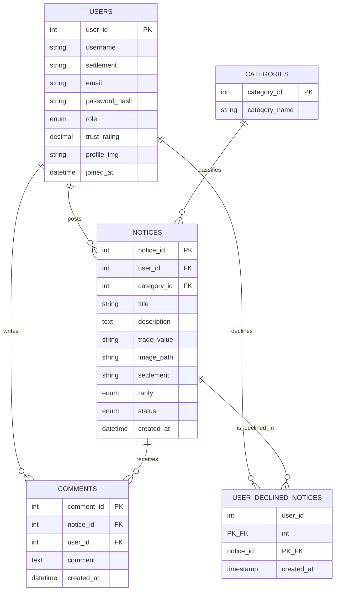
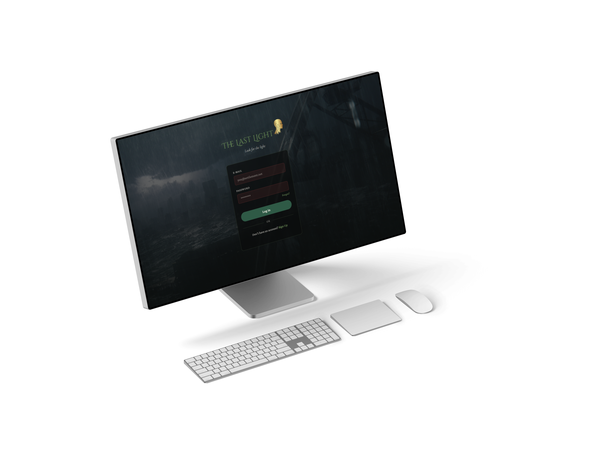
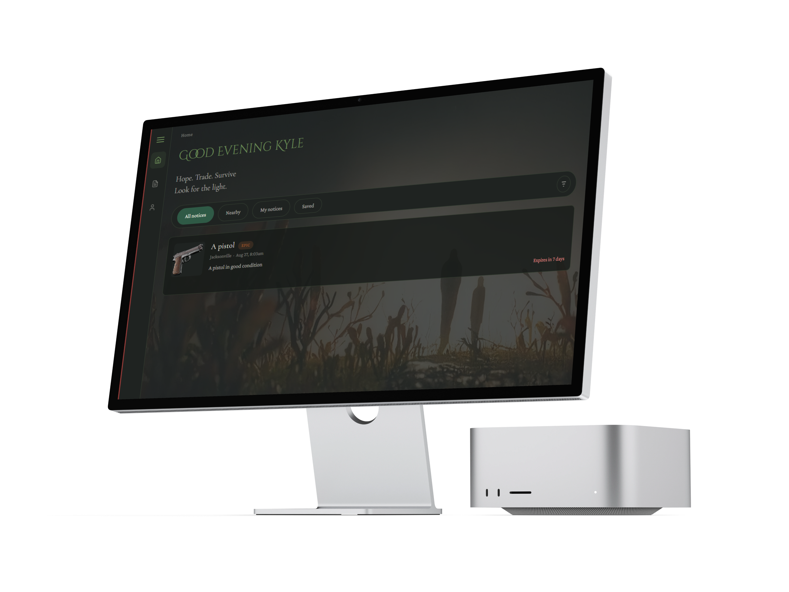
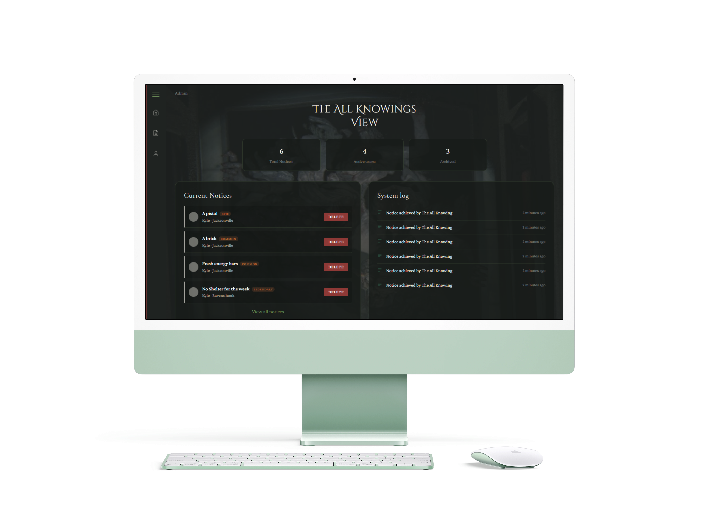

# 🏮 The Last Light

*A dark fantasy survivor marketplace — trade, request, and warn each other after the world fell to The Hollowing.*

Built for **DV200** using **PHP 8.2**, **MySQL (MariaDB)**, and **XAMPP**.

---

## 📖 About

The Last Light is a community notice board for survivors of a magical plague. Users register as a **Survivor** or **Merchant**, post notices (trades, requests, warnings) tagged with a **rarity** (Common → Mythic), comment on each other's posts, accept or decline offers, and build a trust rating over time. Every notice automatically expires after seven days — because in this world, information goes stale fast.

The project fulfils the assignment's three inspiration cards:

| Card | How it's implemented |
|---|---|
| **Human Truth** — *First impressions aren't everything* | Trust ratings build gradually through activity rather than being fixed on sign-up |
| **Behavioural Twist** — *Posts expire after one week* | Enforced in SQL (`created_at > NOW() - INTERVAL 7 DAY`), not just cosmetically |
| **Build Constraint** — *The admin is never named or seen* | The admin dashboard is framed as **"The All Knowing"** — an unseen, automated overseer |

---

## ✨ Features

- 🔐 **Authentication** — register, login, logout, with hashed passwords (`password_hash` / `password_verify`) and session-based access control
- 📋 **Notice board** — create, view, edit, and delete your own notices; filter by category, rarity, and tab (Nearby / My notices / All notices)
- 🤝 **Accept / Decline** — respond to a notice; declined notices are hidden from that user's own feed going forward, without affecting anyone else's view
- 🖼️ **Image uploads** — attach a photo to any notice, validated by file type
- ⭐ **Rarity system** — Common, Uncommon, Rare, Epic, Legendary, Mythic — stored as an ordered `ENUM`, so sorting "by rarity" needs zero extra logic
- ⏳ **Auto-expiry** — notices vanish from the feed after 7 days, calculated entirely in SQL
- 👤 **Profile page** — trust rating, post/comment counts, edit profile, edit & delete your own notices
- 🛡️ **Admin dashboard** ("The All Knowing") — global stats, notice moderation, delete controls
- 💬 **Comments** — threaded discussion on each notice

---

## 🗂️ Project Structure

```
The Last Light/
├── Components/
│   └── sidebar.php            # Shared nav, included on every app page
├── Database/
│   ├── config.php              # DB connection + session start
│   ├── database.sql            # Full schema (import this first)
│   ├── login_process.php       # Login form handler
│   ├── register.php            # Registration form handler
│   ├── logout.php              # Session destroy
│   ├── create_notice.php       # Handles the Create Notice form
│   ├── update_notice.php       # Owner-only notice editing
│   ├── delete_notice.php       # Owner-only notice deletion
│   ├── update_profile.php      # Profile edit handler
│   ├── comment_process.php     # Handles comment submissions
│   └── notice_action.php       # Accept / Decline handling
├── Imgs/
│   └── notices/                 # Uploaded notice photos
├── Pages/
│   ├── login.php
│   ├── signIn.php
│   ├── index.php               # Home feed
│   ├── notice.php              # Single notice + comments
│   ├── profile.php
│   ├── edit_notice.php
│   └── admin.php
├── README.md
└── Style.css                    # Shared stylesheet (dark fantasy theme)
```

---

## 🎨 Design

| | |
|---|---|
| **Headings** | Cinzel Decorative |
| **Sub-headings** | Cormorant Garamond |
| **Body text** | Crimson Pro |

**Palette**

| Charcoal | Dark Green | Forest Green | Moss | Ivory | Rust | Crimson |
|---|---|---|---|---|---|---|
| `#161918` | `#22342D` | `#3D6B4D` | `#738E63` | `#F2EFE7` | `#B76A3B` | `#8E3936` |

---

## 🗄️ Database Schema

Five tables — see [`database.sql`](Database/database.sql) for the full definitions.

- **`users`** — accounts, role (`survivor` / `merchant`), settlement, trust rating
- **`categories`** — Medicine, Food, Weapons, Shelter, Materials, Services, Quests
- **`notices`** — the actual posts, with `rarity` and `status` ENUMs and a foreign key to both `users` and `categories`
- **`comments`** — one-to-many against `notices`, tied to the commenting `user`
- **`user_declined_notices`** — tracks which notices a specific user has declined, so they disappear from *that user's* feed only. Composite primary key (`user_id`, `notice_id`) prevents duplicate entries; `ON DELETE CASCADE` on both foreign keys keeps the table clean if a user or notice is ever removed



---

## 🖼️ High-Fidelity Wireframes

**Login**



**Home Feed**



**Admin Dashboard — "The All Knowing"**



**Profile**


---


## ⚙️ Setup (XAMPP)

1. Clone/copy the project folder into `htdocs/`.
2. Start **Apache** and **MySQL** in the XAMPP Control Panel.
3. Open `http://localhost/phpmyadmin`, go to **Import**, and select `Database/database.sql`.
4. Visit `http://localhost/The%20Last%20Light/Pages/login.php` to get started.

---

## 🧑‍💻 Author

**Gabriel Pulella** — DV200, Open Window Institution